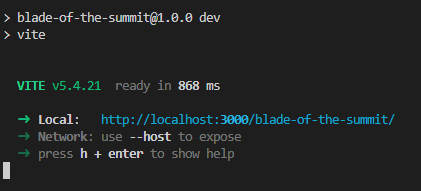

# **⚔️ Blade of the Summit ⚔️** 
> "Throughout heaven and earth, I alone making this game."


```text
Inspired by demon slayer to make this 2D action adventure built with phaser 3 + typescript. 
Ancient shrines,mystery forests, snow biomes and breathing style battlefields feel.
Real ninja spritesheets for the player (tanjiro-coded) + enemies, everything else cooked pixel by pixel. 
Fight powerful enemies, master combat, climb to the summit one map at a time.
```


**Built for Terra Hack Cloud — 12 Week Challenge**  
Made by **GYSK-KRISH**

>Current Day: 11 / 84


---
# 🪄 Features 

 - **Main menu** with *scroll-wheel character select* and *keyboard/mouse* navigation
 - **126×126 snow village** 
- **Procedural pixel art** drawn on canvas at boot: houses, shrine, torii gates, lanterns, pines, rocks, bridge
- **Real character sprites** [(NinjaDark player, NinjaRed enemy)](assets/licenses) from the Ninja Adventure asset pack
- **Y-sorted** so you walk behind and in front of buildings and trees
- **Atmosphere:** falling snow, drifting mist, camera follow with fade-in
- **Collision** for cliffs, ice, trees, houses and props

---

## 🎮 Controls
 
| Action | Keys |
|---|---|
| Move | `W A S D` or Varrow keys` |
| Attack *(in progress)* | `Space` or `J` |
| Menu navigate | `↑ ↓` or `mouse` |
| Menu select | `Enter`, `Space`, `click` |


## 🚀 Run Setup
 
```bash
git clone https://github.com/GYSK-KRISH/blade-of-the-summit.git
cd blade-of-the-summit
npm install
npm run dev
```
> `http://localhost:3000` or `http://localhost:5173`





##  Coding Language 
 
- ***Phaser 3***
- ***TypeScript***
- ***Vite***

## 🗂️ Project Structure

```text
Blade-of-the-Summit/
├── .github/
├── assets/
├── dist/
├── image/
├── node_modules/
├── src/
│   ├── entities/
│   │   ├── Dummy.ts
│   │   └── Player.ts
│   ├── scenes/
│   │   ├── BootScene.ts
│   │   ├── Level0_SnowVillage.ts
│   │   ├── LevelComplete.ts   #not start yet
│   │   └── MainMenu.ts
|   ├── system/
|   |   ├── GameState.ts
|   |   ├── IntersectionMangement.ts
|   |   ├── GuideArrow.ts
|   |   ├── 
|   |   └──
|   |
│   ├── types/
│   │   └── index.ts
│   └── main.ts
├── .gitignore
├── index.html
├── package-lock.json
├── package.json
├── README.md
├── tsconfig.json
└── vite.config.ts
```

---
## 💡 Things I Learned

- **Efficient map rendering:** 
- **Diagonal movement:**
- **Collision detection:** 
- **Physics world bounds:**
- **Asset Integration**
- **Talking with code**


>There more 11 weeks to go. More to build, more to learn and  more to grow.

----


## 📅 Progress
## 12-Week Roadmap — Blade of the Summit
**Terra Hack Cloud Challenge**

---

### Week 1 — Foundations
- **Day 1** — Scaffolding, player movement, basic attack, dummy ✅
- **Day 2** — Full snowy valley, atmosphere, props, real tilemap ✅
- **Day 3** — Adding level 0 , mainmenu , full scren ,update BooTscenes built 126x126 snowy village map ✅
- **Day 4** — Ninja assets, combat effects, tilesets and snow village updates ✅
- **Day 5** — Load assets, add tilemap batching and build Snow Village ✅
- **Day 6** — Making new house,add lanterns and sloving some bugs ✅
- **Day 7** — Writing Readme file ✅

---

### Week 2
- **Day 8** —  Fix MainMenu character selector , visible names and texture keys ✅

- **Day 9** —  Rewrote level0 completely also added NPCs, HUD, lighting, procedural , forest density, river blockers ,smoke from chimneys,torii gates walk ✅
- **Day 10** — GameState and added into Level0_SnowVillage ✅
- **Day 11** — Interaction manager and guide arrow are working ✅
- **Day 9** —  I have rewrote level0 completely also added NPCs, HUD, lighting, procedural , forest density, river blockers ,smoke from chimneys,torii gates walk 
- **Day 10** — GameState (single source of truth: quests, journal, flags, tutorial, guide-arrow query) + wired into Level0 + InteractionManager stub ✅
- **Day 11** — 
- **Day 12** — 
- **Day 13** — 
- **Day 14** — 

---

### Week 3
- **Day 15** — 
- **Day 16** — 
- **Day 17** — 
- **Day 18** — 
- **Day 19** — 
- **Day 20** — 
- **Day 21** — 

---

### Week 4
- **Day 22** — 
- **Day 23** — 
- **Day 24** — 
- **Day 25** — 
- **Day 26** — 
- **Day 27** — 
- **Day 28** — 

---

### Week 5
- **Day 29** — 
- **Day 30** — 
- **Day 31** — 
- **Day 32** — 
- **Day 33** — 
- **Day 34** — 
- **Day 35** — 

---

### Week 6
- **Day 36** — 
- **Day 37** — 
- **Day 38** — 
- **Day 39** — 
- **Day 40** — 
- **Day 41** — 
- **Day 42** — 

---

### Week 7
- **Day 43** — 
- **Day 44** — 
- **Day 45** — 
- **Day 46** — 
- **Day 47** — 
- **Day 48** — 
- **Day 49** — 

---

### Week 8
- **Day 50** — 
- **Day 51** — 
- **Day 52** — 
- **Day 53** — 
- **Day 54** — 
- **Day 55** — 
- **Day 56** — 

---

### Week 9
- **Day 57** — 
- **Day 58** — 
- **Day 59** — 
- **Day 60** — 
- **Day 61** — 
- **Day 62** — 
- **Day 63** — 

---

### Week 10
- **Day 64** — 
- **Day 65** — 
- **Day 66** — 
- **Day 67** — 
- **Day 68** — 
- **Day 69** — 
- **Day 70** — 

---

### Week 11
- **Day 71** — 
- **Day 72** — 
- **Day 73** — 
- **Day 74** — 
- **Day 75** — 
- **Day 76** — 
- **Day 77** — 

---

### Week 12
- **Day 78** — 
- **Day 79** — 
- **Day 80** — 
- **Day 81** — 
- **Day 82** — 
- **Day 83** — 
- **Day 84** — 

---


**Current Status:** Day 11 complete  
**Next Up:** Day 12 

---

##  Credits
 
>- Sprites and tilesets: [**Ninja Adventure Asset Pack**](https://pixel-boy.itch.io/ninja-adventure-asset-pack)
>- Engine: [Phaser 3](https://phaser.io/)
>- **YouTube Channels I Learn From :**
>1.  [Phaser](https://www.youtube.com/@PhaserYouTube)
>2.  [Apan college](https://www.youtube.com/@ApnaCollegeOfficial)
>3.  [JSLegendDev](https://www.youtube.com/@JSLegendDev)
>4.  [Game Maker's Toolkit](https://www.youtube.com/@GMTK)
>5.  [Brackeys](https://www.youtube.com/@Brackeys) 
>6.  [Dani](https://www.youtube.com/@danidev) 
>7.  [Sebastian Lague](https://www.youtube.com/@SebastianLague)
>8.  [HeartBeast](https://www.youtube.com/@uheartbeast)
>9.  [freeCodeCamp.org](https://www.youtube.com/@freecodecamp) 
>10. [Power of Knowledge](https://www.youtube.com/@PowerofKnowledge)

---


## License

licensed under the [MIT License.](LICENSE) Go wild!
